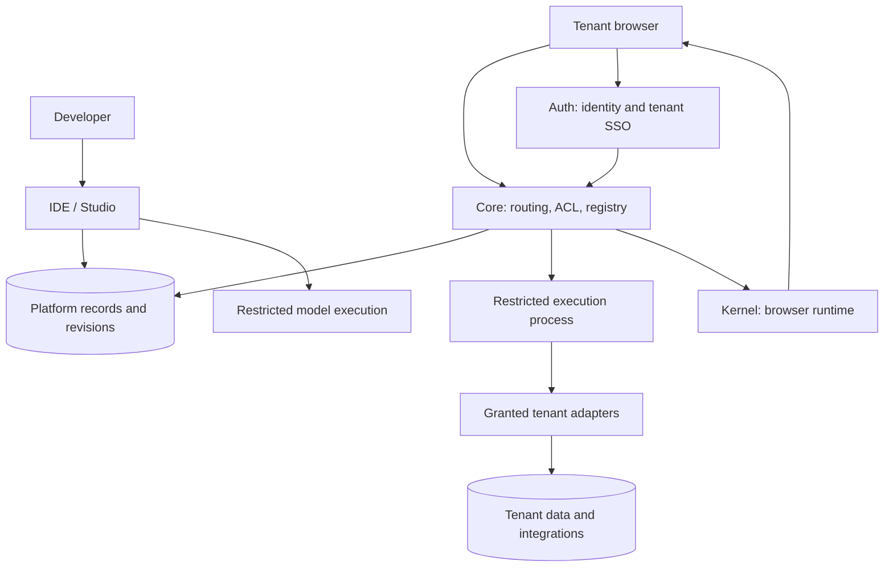

<div align="center">

# IdpCore

### برنامه را بساز؛ پلتفرم به کارش ادامه می‌دهد.

پلتفرم TypeScript برای ساخت و اجرای زندهٔ بک‌اند، مدل‌های داده و رابط React، روی زیرساخت خودتان.

[صفحهٔ فارسی پروژه](https://alirezadadrass.github.io/Idp/fa/) · [مستندات](docs/README.md) · [نصب](docs/getting-started.md) · [English](README.md)

</div>


**پیش‌نمایش توسعه‌دهندگان · مجوز Apache 2.0 · قابل نصب روی زیرساخت خودتان**

IdpCore برای برنامهٔ هر مستاجر یک مسیر توسعهٔ کامل فراهم می‌کند: منطق بک‌اند را
می‌نویسید، داده را مدل می‌کنید، رابط React می‌سازید، دسترسی‌ها را تعیین می‌کنید،
پیش‌نویس را می‌بینید و نسخه‌ای را منتشر می‌کنید. Core هنگام رسیدن درخواست، کد
برنامه را انتخاب و اجرا می‌کند؛ Kernel بسته‌های رابط را در مرورگر بارگذاری
می‌کند. تغییر کد مستاجر به ساخت یا راه‌اندازی مجدد سرویس‌های پلتفرم نیاز ندارد.

ریپو شامل محیط اجرای سمت سرور و مرورگر، IDE، سرویس هویت و ورود یکپارچه، بسته‌های
مشترک، افزونهٔ VS Code و ابزارهای اختیاری هوش مصنوعی و زیرساخت است. این نسخه برای
ارزیابی و توسعهٔ پلتفرم منتشر می‌شود. [گزارش بررسی](docs/release/validation.md)
مسیرهای تست‌شده و کارهای باقی‌مانده را مشخص می‌کند؛ آمادگی اجرای عمومی و نامحدود
کد، کارایی تولید و انطباق کامل OIDC ادعا نمی‌شود.

## فهرست

- [چرا IdpCore؟](#چرا-idpcore)
- [قابلیت‌های پلتفرم](#قابلیتهای-پلتفرم)
- [از تغییر کد تا اجرای برنامه](#از-تغییر-کد-تا-اجرای-برنامه)
- [یک برنامه در سه لایه](#یک-برنامه-در-سه-لایه)
- [معماری و مسئولیت‌ها](#معماری-و-مسئولیتها)
- [داده، اتصال‌ها و رمزها](#داده-اتصالها-و-رمزها)
- [راه‌اندازی](#راهاندازی)
- [نقشهٔ ریپو](#نقشهٔ-ریپو)
- [توسعه و بررسی تغییرات](#توسعه-و-بررسی-تغییرات)
- [محدودیت‌های محیط نصب](#محدودیتهای-محیط-نصب)
- [مستندات، مشارکت و مجوز](#مستندات-مشارکت-و-مجوز)

## چرا IdpCore؟

وقتی چند برنامه روی یک پلتفرم ساخته می‌شوند، تغییر منطق هر برنامه نباید الزاماً
به انتشار دوبارهٔ خود پلتفرم تبدیل شود. IdpCore ماژول‌ها و بسته‌های رابط مستاجر
را به‌عنوان اجزای برنامه نگه می‌دارد؛ پیش‌نویس و نسخهٔ منتشرشدهٔ آن‌ها جدا هستند.
توسعه‌دهنده می‌تواند برنامهٔ یک مستاجر را تغییر بدهد، بدون اینکه Core یا IDE را
دوباره بسازد و راه‌اندازی کند.

همان فضای کاری، handlerهای HTTP، مدل‌های اجرایی ORM، بسته‌های React، قوانین
دسترسی، پیش‌نمایش، انتشار و تاریخچه را کنار هم می‌آورد. پروژه‌های مشترک هم اجازه
می‌دهند منطق بک‌اند و کامپوننت‌ها بین برنامه‌ها استفاده شوند.

پنل‌های داخلی، پورتال‌های سازمانی، برنامه‌های کسب‌وکار چندمستاجری و داشبوردهای
متصل به سرویس‌های بیرونی از کاربردهای این اجزا هستند. این‌ها نمونهٔ کاربردند؛
ریپو محصول آماده و کامل برای هر یک از این سناریوها ارائه نمی‌کند.

**معنای اجرای زنده:** کد برنامه هنگام فراخوانی و بستهٔ رابط هنگام بارگذاری انتخاب
می‌شود. تغییر سورس پلتفرم همچنان ساخت می‌خواهد؛ تغییر مدل و جدول‌ها همچنان نیاز
به عملیات آگاهانهٔ ساختار دارد. انتشار ماژول، مهاجرت دیتابیس نیست و بازگردانی کد،
داده را به عقب برنمی‌گرداند.

## قابلیت‌های پلتفرم

| بخش | قابلیت موجود | راهنمای مرتبط |
| --- | --- | --- |
| اجرای بک‌اند | handlerهای JavaScript، انتخاب مسیر و متد، تعیین مستاجر، پاسخ HTTP و امکانات کامپایل زنده | [بک‌اند و مدل‌ها](docs/platform-cookbook/02-backend-modules.md) |
| مدل داده | کلاس‌های بومی TypeORM با decorator، متد و رابطه روی اتصال نام‌دار مستاجر | [روند تغییر مدل](docs/platform/authoring.md#models-have-a-separate-schema-lifecycle) |
| رابط مرورگر | بسته‌های React، وابستگی‌ها، CSS، مسیرها و کلاینت API آگاه از نشست با Kernel | [راهنمای رابط](docs/platform-cookbook/04-ui-modules.md) |
| محیط توسعه | Monaco، ویرایش دوگانه، مقایسه، جست‌وجو، پیش‌نمایش، بازرسی، آماده‌سازی، تاریخچه و بازگردانی | [توسعه و انتشار](docs/platform/authoring.md) |
| انتشار نسخه | اجزای جداگانهٔ پیش‌نویس و منتشرشدهٔ ماژول و رابط؛ تاریخچه و درخواست انتشار | [چرخهٔ برنامه](docs/platform/authoring.md#drafts-and-published-artifacts) |
| مدیریت مستاجر | hostname، تیم، مجوز آداپتور، ارجاع رمز، سیاست ثبت‌نام، برند و تنظیم اختیاری PWA | [تنظیم مستاجر](docs/platform-cookbook/01-tenant-config.md) |
| دسترسی‌ها | مجوز تیم و منابع در IDE؛ permission، نقش و ACL مسیر در اجرای برنامه | [راهنمای ACL](docs/platform-cookbook/03-acl.md) |
| هویت | سرویس Auth برای حساب‌ها، سازمان‌ها، نقش‌ها و روند OAuth/SSO مستاجر | [مرز هویت](docs/platform/overview.md#identity-and-access) |
| استفادهٔ مجدد | پروژه‌های چندفایلی بک‌اند و بسته‌های رابط با انتشار نسخه‌دار | [پروژه‌های مشترک](docs/platform-cookbook/05-shared-projects.md) |
| توسعهٔ محلی | افزونهٔ VS Code برای دریافت و ارسال فضای کاری، ساخت فایل و پیش‌نمایش | [ابزار توسعه](docs/platform/tooling.md) |
| هوش مصنوعی | دستیار آگاه از فضای کاری و درگاه اختیاری Codex CLI با خروجی جریانی | [دستیار](docs/platform/tooling.md#assistant-and-codex) |
| عملیات | نمونه‌ها و هشدارهای مانیتورینگ، گزارش پالایش‌شده و مدیریت اختیاری Docker/Podman | [ابزارهای زیرساخت](docs/platform/tooling.md#monitoring-and-container-operations) |

## از تغییر کد تا اجرای برنامه

1. **نوشتن:** در Studio مستاجر را انتخاب کنید. ماژول، مدل، بستهٔ رابط و ACL را
   ویرایش کنید. کد قابل استفادهٔ مجدد را در پروژهٔ مشترک قرار دهید.
2. **ذخیره و پیش‌نمایش:** پیش‌نویس را ذخیره کنید و با دسترسی توسعه‌دهندهٔ همان
   مستاجر بررسی کنید. ترافیک برنامه از اجزای منتشرشدهٔ ماژول و رابط استفاده می‌کند.
3. **مرور و انتشار:** تفاوت‌ها و تاریخچه را ببینید، تغییرات را انتخاب کنید و از
   مسیر انتشار مناسب استفاده کنید. انتشار، کد قابل اجرا را تعیین و کش مرتبط را
   بی‌اعتبار می‌کند.
4. **اجرا:** Core مستاجر و دسترسی مسیر را تعیین و کد انتخاب‌شده را در پردازش
   محدودشده اجرا می‌کند. Kernel بسته‌های رابط را می‌خواند و اجرا می‌کند.
5. **تکرار:** پیش‌نویس تازه‌ای بسازید، دو حالت را مقایسه کنید و دوباره منتشر کنید.
   بازگردانی نسخه، سورس پیش‌نویس را برمی‌گرداند؛ انتشار دوباره تصمیم جداگانه است.

مدل، ACL و تنظیمات الزاماً همان رفتار انتشار ماژول و رابط را ندارند.
[راهنمای چرخهٔ توسعه](docs/platform/authoring.md) این تفاوت‌ها را توضیح می‌دهد.

## یک برنامه در سه لایه

مثال زیر اتصال بخش‌های یک برنامهٔ سفارش‌ها را نشان می‌دهد. پیش‌نیاز آن، مجوز و
تنظیم آداپتور `orders`، جدول‌های مدل، ACL مسیر و نقطهٔ ورود منتشرشدهٔ رابط است.
برای شروع بدون آماده‌سازی دیتابیس برنامه، [آموزش HTTP و React](docs/tutorials/first-application.md)
را دنبال کنید.

### ۱. مدل بومی داده

در `Models/Order.js` یک کلاس اجرایی TypeORM می‌نویسید. decorator، رابطه و متدهای
مدل حفظ می‌شوند؛ مدل صرفاً توصیف JSON نیست.

```js
const { Entity, PrimaryGeneratedColumn, Column, CreateDateColumn } = require('typeorm');

@Entity({ name: 'orders' })
class Order {
  @PrimaryGeneratedColumn('uuid') id;
  @Column({ type: 'varchar' }) title;
  @CreateDateColumn() createdAt;
}

module.exports = { Order };
```

ذخیرهٔ مدل در Studio، همگام‌سازی ساختار دیتابیس مستاجر را هم از مسیر مهاجرت مدل
امتحان می‌کند. پیش از ذخیرهٔ تغییر مدل روی دادهٔ موجود، برنامهٔ تغییر و پشتیبان
داشته باشید. این روند با مهاجرت نسخه‌دار جدول‌های پلتفرم متفاوت است؛ جزئیات در
[راهنمای مدل](docs/platform-cookbook/02-backend-modules.md) آمده است.

### ۲. مسیر بک‌اند مستاجر

یک ماژول GET در `/api/orders` بسازید. اتصال داده از آرگومان آداپتور تزریق‌شده و
با کلید مجاز `postgres:orders` دریافت می‌شود.

```js
module.exports = async function handler(req, adapters) {
  const orm = await adapters.orm('postgres:orders');
  const orders = await orm.getRepository('Order').find({
    order: { createdAt: 'DESC' },
    take: 20,
  });
  return { statusCode: 200, body: { orders } };
};
```

ماژول را ذخیره و منتشر کنید. مجوز `orders.read` را در ACL مسیر تعریف و به نقش
مناسب بدهید. مسیر عمومی فقط با فعال‌کردن صریح دسترسی ناشناس ایجاد می‌شود.

### ۳. نقطهٔ ورود React

بستهٔ `@app/dashboard` را بسازید. برای درخواست‌های برنامه از کلاینت Kernel
استفاده کنید؛ داده از API واقعی دریافت می‌شود.

```jsx
import React, { useState } from 'react';
import { useApiClient } from '@app/datacontext';

export function App() {
  const api = useApiClient();
  const [orders, setOrders] = useState([]);
  const [busy, setBusy] = useState(false);
  const [error, setError] = useState('');

  async function refresh() {
    setBusy(true);
    setError('');
    try {
      const response = await api.get('/api/orders');
      if (!response.ok) throw new Error(`Request failed (${response.status})`);
      setOrders((await response.json()).orders);
    } catch (failure) {
      setError(failure.message);
    } finally {
      setBusy(false);
    }
  }

  return <section>
    <h1>Orders</h1>
    <button onClick={refresh} disabled={busy}>{busy ? 'Loading…' : 'Load orders'}</button>
    {error && <p role="alert">{error}</p>}
    {orders.map(order => <p key={order.id}>{order.title}</p>)}
  </section>;
}
```

رابط را ذخیره کنید، پیش‌نمایش بگیرید و منتشر کنید. نقطهٔ ورود پیش‌فرض، خروجی
نام‌دار `App` دارد. سایر کامپوننت‌ها با نام بسته وارد می‌شوند. کلاینت API یک
`Response` برمی‌گرداند؛ وضعیت پاسخ و تبدیل JSON را صریح انجام دهید.

## معماری و مسئولیت‌ها



| جزء | مسئولیت |
| --- | --- |
| **Core** | تنظیم اجرای مستاجر، رجیستری ماژول و رابط، ACL، انتخاب و اجرای کد و قابلیت آداپتورها |
| **IDE / Studio** | ویرایش، پیش‌نمایش، مرور، انتشار، تاریخچه و روندهای مدیریت |
| **Kernel** | بارگذاری و کش بسته‌ها، سبک‌ها، مسیریابی و زمینهٔ API در مرورگر |
| **Auth** | ورود، ثبت‌نام، نشست هویت، سازمان‌ها، نقش‌ها و اعتماد ورود مستاجر |
| **Shared** | entityها، قراردادهای سرویس‌ها، ابزار پردازش محدودشده و مهاجرت پلتفرم |

پردازش محدودشده داخل **همان سرویس‌های Core و IDE** اجرا می‌شود؛ سرویس، پورت یا
broker مستقل برای اجرای کد اضافه نشده است. پردازش اصلی کلیدهای پلتفرم را نگه
می‌دارد و مستاجر، حالت اجرا و دسترسی‌ها را تعیین می‌کند. رمز اتصال مجاز مستاجر
در زمینهٔ اجرای مربوط در دسترس است؛ نقش دیتابیس و سیاست شبکه باید محدود باشند.

PostgreSQL رکوردهای پلتفرم را نگه می‌دارد؛ Redis برای کش و نشست استفاده می‌شود.
اتصال دادهٔ برنامه و دیتابیس هویت نقش جدا دارند.
[نقشهٔ معماری](docs/site/docs/architecture/idpcore-map.md) و
[طراحی محیط اجرا](docker/runtime/README.md) جزئیات را توضیح می‌دهند.

## داده، اتصال‌ها و رمزها

| اتصال | قابلیت |
| --- | --- |
| PostgreSQL، MySQL، SQL Server | repositoryهای ORM و آداپتورهای query با حالت خواندن و نوشتن |
| Redis | کلید و مقدار، انقضا و pub/sub |
| Kafka | انتشار پیام |
| S3 | ذخیرهٔ object و ساخت URL امضاشده |
| HTTP | درخواست بیرونی با تنظیم مهلت |
| اطلاعات سازمان | سازمان، واحد و کاربران بر اساس تنظیم Auth |
| بستهٔ بک‌اند مشترک | بارگذاری نسخه با `adapters.shared.require` |

این‌ها رابط‌های موجودند؛ سرویس‌های لازم برای هر برنامه خودکار ساخته نمی‌شوند.
اتصال واقعی PostgreSQL در بررسی انتشار تست شده؛ همهٔ ترکیب‌های ارائه‌دهنده و
بک‌اند به‌صورت سرتاسری تأیید نشده‌اند.

رمزها را در فضای رمز مستاجر ذخیره و در تنظیم اتصال با کلید ارجاع دهید. رمز نصب
را در ماژول، رابط یا تنظیم عمومی ننویسید. مجوز آداپتور جایگزین محدودیت دیتابیس،
bucket یا شبکه نیست.

## راه‌اندازی

اجرای زنده به لینوکس با user namespace و bubblewrap نیاز دارد. از Node نسخهٔ
**22.13 به بالا در شاخهٔ 22**، npm، PostgreSQL 17 و Redis استفاده کنید. ایمیج‌ها
bubblewrap دارند؛ سیاست میزبان هم باید اجازهٔ اجرا بدهد. اجرای زندهٔ بومی روی
Windows/macOS پشتیبانی نمی‌شود؛ ماشین مجازی لینوکس سازگار یک گزینه است.

این بخش فقط مرحلهٔ اولیهٔ نصب وابستگی و تولید تنظیمات است:

```sh
git clone https://github.com/AlirezaDadrass/Idp.git
cd Idp
npm ci
npm --prefix src/auth ci
npm --prefix src/kernel ci
npm --prefix src/monitoring ci
npm --prefix src/container-agent ci
npm run docker:init-env
```

سپس [راهنمای کامل نصب](docs/getting-started.md) را دنبال کنید:

1. تنظیمات خصوصی، دامنه‌های محلی و originهای مجاز را بررسی کنید.
2. ایمیج Core، Auth، IDE و مانیتورینگ را بسازید.
3. PostgreSQL و Redis را شروع و مهاجرت‌های Core و IDE را اجرا کنید.
4. برنامه‌ها را شروع و با حساب نصب وارد IDE شوید.
5. مستاجر `localhost` را بسازید و [اولین برنامه](docs/tutorials/first-application.md) را منتشر کنید.

| بخش محلی | نشانی |
| --- | --- |
| IDE | `http://localhost:3002` |
| Core | `http://localhost:3005`؛ نیازمند مستاجر و برنامهٔ تنظیم‌شده |
| Auth | `http://localhost:3015` |

Core و IDE در شروع، جدول‌های پلتفرم را همگام‌سازی نمی‌کنند. نصب تازه به مهاجرت
صریح نیاز دارد. برای نصب موجود، اول پشتیبان، بررسی ساختار و پذیرش مطابق
[راهنمای مهاجرت](scripts/database/README.md) انجام می‌شود. Auth مهاجرت SQL مستقل
دارد. تنظیمات خصوصی برای هر نصب جدا هستند و وارد Git نمی‌شوند.

## نقشهٔ ریپو

```text
src/core/             اجرای مستاجر، رجیستری، ACL، آداپتورها و بک‌اند
src/ideNew/           محیط توسعهٔ Next.js، انتشار و مدیریت
src/auth/             هویت، سازمان‌ها و ورود مستاجر
src/kernel/           بارگذاری و اجرای بسته‌های مرورگر
src/packages/shared/  entity، قرارداد، پردازش محدودشده و مهاجرت
src/ide-vscode/       افزونهٔ توسعهٔ محلی مستاجر
src/monitoring/       دریافت و مدیریت دادهٔ مانیتورینگ
src/container-agent/  عامل اختیاری Docker و Podman
src/codex-gateway/    رابط اختیاری HTTP/SSE برای Codex CLI
docs/platform/        معرفی قابلیت‌ها، توسعه و ابزارها
docs/tutorials/       آموزش ساخت برنامه
docs/platform-cookbook/ دستورالعمل بک‌اند، مدل، رابط و دسترسی
docs/site/            سایت و مرجع تولیدشده از سورس
docs/release/         بررسی انتشار و وابستگی‌ها
scripts/database/     مدیریت صریح ساختار پلتفرم
scripts/security/     بررسی اجرا، گزارش و رمزها
docker/               ایمیج‌ها، تنظیمات و سیاست اجرا
```

برای تغییر اجرای بک‌اند از `server.ts` در Core، routerها، `Dispatcher` و
`SandboxRunner` شروع کنید. برای تغییر محیط توسعه، کامپوننت‌ها و hookهای editor
و API متناظر IDE را ببینید. بارگذاری رابط از `src/kernel/src/index.ts` شروع می‌شود.
[راهنمای توسعه‌دهنده](docs/developer-guide.md) مسیرها را به هم وصل می‌کند.

## توسعه و بررسی تغییرات

پس از نصب و آماده‌سازی ساختار پلتفرم، `npm run apps:dev` سه برنامهٔ Core، IDE و
Auth را اجرا می‌کند. ابزارهای اختیاری به تنظیم مستقل نصب نیاز دارند.

| حوزهٔ تغییر | بررسی مناسب |
| --- | --- |
| Core و Shared | `npm run build:shared`، ساخت Core و تست‌های آن |
| دسترسی و توسعه در IDE | type-check و `test:security` در IDE |
| Auth، Kernel و VS Code | ساخت و بررسی نوع همان بسته |
| محیط اجرای محدودشده | `test:runtime` و `test:runtime:integration` |
| ساختار و نصب تازه | `test:database`، `test:installation` و `test:container` |
| گزارش و تنظیمات | `test:logging`، `test:env-setup` و `test:tls` |
| سورس قابل انتشار | `security:secrets`، `security:history` و `security:dependencies` |

تست‌های یکپارچگی و نصب از کانتینر موقت PostgreSQL و رمز مصنوعی استفاده می‌کنند؛
تست اجرا نیازمند میزبان لینوکس سازگار است. بررسی متناسب با تغییر را انتخاب کنید.
[گزارش بررسی](docs/release/validation.md) محدودیت شواهد را مشخص می‌کند. گزارش
وابستگی عمداً تا باقی‌ماندن یافته‌های پرخطر، وضعیت ناموفق برمی‌گرداند.

برای ساخت سایت مستندات:

```sh
npm --prefix docs/site ci
npm run docs:build
npm run docs:serve
```

ساخت سایت، راهنماهای اصلی را همگام و فهرست مسیرها و سرویس‌ها را از سورس تولید
می‌کند. راهنمای اصلی را ویرایش کنید، نه نسخهٔ تولیدشده را. صفحهٔ معرفی فارسی و
انگلیسی است؛ مستندات فنی فعلاً انگلیسی هستند.

## محدودیت‌های محیط نصب

- جداسازی پردازش به سیاست سازگار namespace، seccomp و کنترل دسترسی میزبان نیاز
  دارد. مسیر جایگزین اجرای کد در پردازش اصلی وجود ندارد.
- دسترسی شبکهٔ اتصال‌ها حفظ شده است. محدودسازی مقصد و جلوگیری از SSRF به سیاست
  محیط نصب نیاز دارد.
- سقف حافظهٔ V8، سقف کل حافظهٔ پردازش نیست. بودجهٔ واقعی CPU، حافظه، درخواست و
  فایل موقت را در زیرساخت تعیین کنید.
- دیتابیس و ذخیره‌ساز مستاجر باید مجوز محدود داشته باشند. مهاجرت پلتفرم و تغییر
  ساختار مدل مستاجر دو روند متفاوت‌اند.
- عامل مدیریت کانتینر ابزار مدیر نصب است؛ آن را عمومی نکنید و socket موتور را
  به کد مستاجر ندهید.
- هشدارهای پرخطر وابستگی‌ها ثبت شده‌اند. آزمون بار، بازیابی پشتیبان و بررسی کامل
  ورود یکپارچهٔ تعاملی هنوز کار جداگانه می‌خواهند.

[امنیت](SECURITY.md)، [وابستگی‌ها](docs/dependencies.md)، [نقشهٔ راه](ROADMAP.md) و
[راهنمای انتشار](docs/release/README.md) را مرور کنید. پاک‌کردن تاریخچه، کلید
قدیمی را در ارائه‌دهندهٔ سرویس باطل نمی‌کند.

## مستندات، مشارکت و مجوز

| هدف | شروع |
| --- | --- |
| شناخت پلتفرم | [معرفی قابلیت‌ها](docs/platform/overview.md) |
| ساخت اولین برنامه | [نصب](docs/getting-started.md) ← [آموزش HTTP و React](docs/tutorials/first-application.md) |
| توسعهٔ برنامهٔ مستاجر | [Cookbook](docs/platform-cookbook/README.md) و [چرخهٔ توسعه](docs/platform/authoring.md) |
| توسعهٔ خود پلتفرم | [راهنمای توسعه‌دهنده](docs/developer-guide.md) و [نقشهٔ معماری](docs/site/docs/architecture/idpcore-map.md) |
| عملیات و ارتقا | [Docker](docker/README.md)، [مهاجرت](scripts/database/README.md) و [امنیت](SECURITY.md) |
| مرور API | [فهرست مسیرها](docs/site/docs/reference/routes.md)؛ فهرست سورس است، نه قرارداد API تست‌شده |
| مشارکت | [CONTRIBUTING](CONTRIBUTING.md)، [رفتار مشارکت](CODE_OF_CONDUCT.md) و issueهای پروژه |

بهبود محیط اجرا، ابزار توسعه، مثال برنامه، دسترس‌پذیری، تست و مستندات همگی مسیر
مشارکت‌اند. تغییر را متمرکز نگه دارید و شواهد متناسب با رفتار ارائه کنید. یافتهٔ
امنیتی حساس را از مسیر خصوصی [سیاست امنیت](SECURITY.md) گزارش دهید.

کد و مستندات اصلی پروژه تحت [Apache 2.0](LICENSE) و همراه [NOTICE](NOTICE) هستند.
کد و کتابخانهٔ شخص ثالث مجوز خود را حفظ می‌کنند؛ [اعلان‌ها](THIRD_PARTY_NOTICES.md)
را بررسی کنید. استفادهٔ تجاری با رعایت شروط مجوز مجاز است؛ حقوق علامت تجاری
واگذار نمی‌شود.
