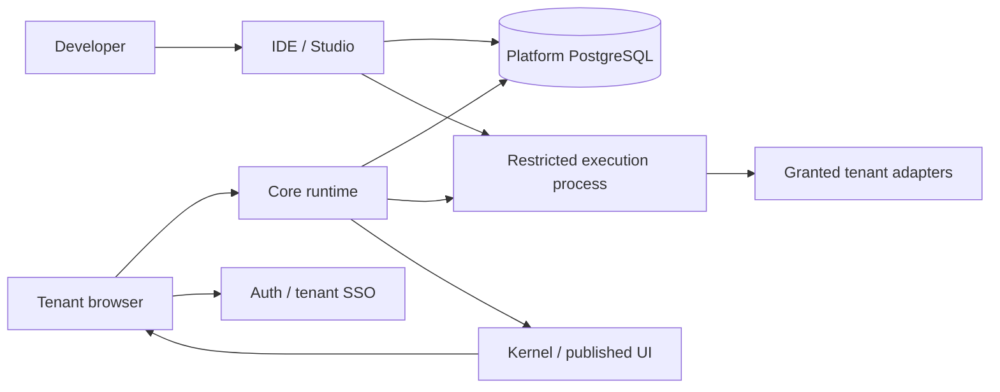

# IdpCore

**Build tenant applications. Change their code while the platform keeps running.**

IdpCore is a self-hosted TypeScript platform for authoring and running tenant-specific
backend modules, database models and React interfaces. Its browser IDE manages drafts,
previews, published revisions and shared packages. Core executes the selected code
on demand; tenant edits do not require rebuilding or restarting the platform.

[Documentation](https://alirezadadrass.github.io/Idp/) ·
[Getting started](docs/getting-started.md) ·
[Contributing](CONTRIBUTING.md) ·
[Security](SECURITY.md) ·
[Apache-2.0](LICENSE)

[راهنمای فارسی](README.fa.md)

**Status: developer preview.** This repository exposes a working foundation and its
tests, with documented deployment limits. It does not claim a hardened public SaaS,
certified tenant isolation, full OIDC conformance or production performance guarantees.

## What you can build

- HTTP backend modules written in JavaScript/TypeScript, selected per tenant and route.
- Native TypeORM model classes, methods, relations and explicit tenant schema actions.
- React UI packages delivered through the Kernel browser runtime.
- Shared backend/UI projects with versioned draft and publish workflows.
- Tenant applications using granted SQL, ORM, HTTP, Redis and other configured adapters.
- Authentication and tenant SSO through the included Auth service.

For example, a backend module can export:

```js
module.exports = async function handler(req, adapters) {
  return {
    statusCode: 200,
    body: { message: 'Hello from live tenant code' },
  };
};
```

Save and publish through the IDE. The next invocation uses the selected revision.
See the [backend cookbook](docs/platform-cookbook/02-backend-modules.md) for models
and database adapters, and the [UI cookbook](docs/platform-cookbook/04-ui-modules.md).

## Architecture



| Component | Responsibility | Source |
| --- | --- | --- |
| Core | Tenant dispatch, ACL, registry, live execution and adapters | `src/core` |
| IDE | Authoring, preview, publish, revisions and administration | `src/ideNew` |
| Auth | Login, tenant SSO, identity and organization membership | `src/auth` |
| Kernel | Loading and mounting tenant UI in the browser | `src/kernel` |
| Shared | Cross-service entities, runtime boundary and schema migrations | `src/packages/shared` |
| Optional tools | Monitoring, container management, AI gateway and VS Code extension | `src/monitoring`, `src/container-agent`, `src/codex-gateway`, `src/ide-vscode` |

Live execution uses short-lived restricted processes **inside the existing Core and
IDE services**. There is no additional execution service, port or message broker.
Platform keys and database credentials stay in the parent. Tenant capabilities are
bound to the tenant and revision selected by that parent.

Read the [runtime boundary](docker/runtime/README.md) and
[architecture map](docs/site/docs/architecture/idpcore-map.md) before changing it.

## Start here

Requirements for the supported live runtime:

- Linux x86-64 or arm64 with unprivileged user namespaces available.
- Node.js **22.13 or later in the 22.x line**, npm, PostgreSQL 17 and Redis.
- Bubblewrap for native development; the Core and IDE images include it.
- Docker Compose or Podman with a compatible Compose provider for container setup.

```sh
git clone https://github.com/AlirezaDadrass/Idp.git
cd Idp
npm ci
npm --prefix src/auth ci
npm --prefix src/kernel ci
npm --prefix src/monitoring ci
npm --prefix src/container-agent ci
npm run docker:init-env
```

The last command generates private, installation-specific credentials; existing
complete configurations are preserved. Review domains and allowed origins before
starting services. Follow [Getting started](docs/getting-started.md) for database
initialization, image builds, file permissions and the first IDE login.

Core and IDE **never synchronize platform tables at startup**. New installations
must apply the explicit platform migrations; existing installations must back up,
validate and adopt their schema first. See the [migration guide](scripts/database/README.md).
Auth maintains its own SQL migration stream.

## Verify a change

```sh
npm run build:shared
npm --prefix src/core run build
npm --prefix src/ideNew run type-check
npm --prefix src/core test
npm --prefix src/ideNew run test:security
npm run test:logging
npm run test:env-setup
npm run test:database
npm run test:runtime
npm run test:runtime:integration
npm run test:installation
npm run test:tls
npm run test:container
```

Database and integration checks create disposable PostgreSQL containers with synthetic
credentials. Runtime checks require the Linux isolation prerequisites. They do not
use installation secrets or change deployment databases. The repository workflows
run these checks against a locked installation; a green check is evidence for the
tested behavior, not a claim about every deployment.

For the documentation site:

```sh
npm --prefix docs/site ci
npm run docs:build
npm run docs:serve
```

## Deployment boundaries

- Restrict adapter credentials to the tenant's databases and schemas.
- Network access is available to integrations; the runtime does not enforce an egress
  allowlist or prevent SSRF. Do not expose it as an untrusted public code playground.
- V8 heap limits are not total process memory limits. Configure container CPU/memory
  budgets, request limits and network policy for the installation.
- Rehearse upgrades and backup restoration on staging. Tenant-authored model schema
  actions are separate from the versioned platform migrations.
- AI providers, SMS integrations and infrastructure agents are optional and require
  their own credentials and access policy. The container agent can control an engine;
  do not expose it or mount an engine socket into tenant execution.

See [SECURITY.md](SECURITY.md), [release preparation](docs/release/README.md) and
[ROADMAP.md](ROADMAP.md). Historical credentials must be revoked at their providers;
removing them from Git does not revoke them.

## Contributing and licensing

Small, tested contributions are welcome. Start with [CONTRIBUTING.md](CONTRIBUTING.md)
and use [issues](https://github.com/AlirezaDadrass/Idp/issues) for reproducible bugs or
scoped proposals. Report sensitive findings through the private security channel,
not a public issue.

Original IdpCore code and documentation are licensed under [Apache-2.0](LICENSE).
This permits commercial use, modification and distribution subject to its conditions,
including preservation of applicable notices. It includes a patent grant and does
not grant trademark rights. Dependencies and bundled third-party code retain their
own licenses; see [THIRD_PARTY_NOTICES.md](THIRD_PARTY_NOTICES.md).
