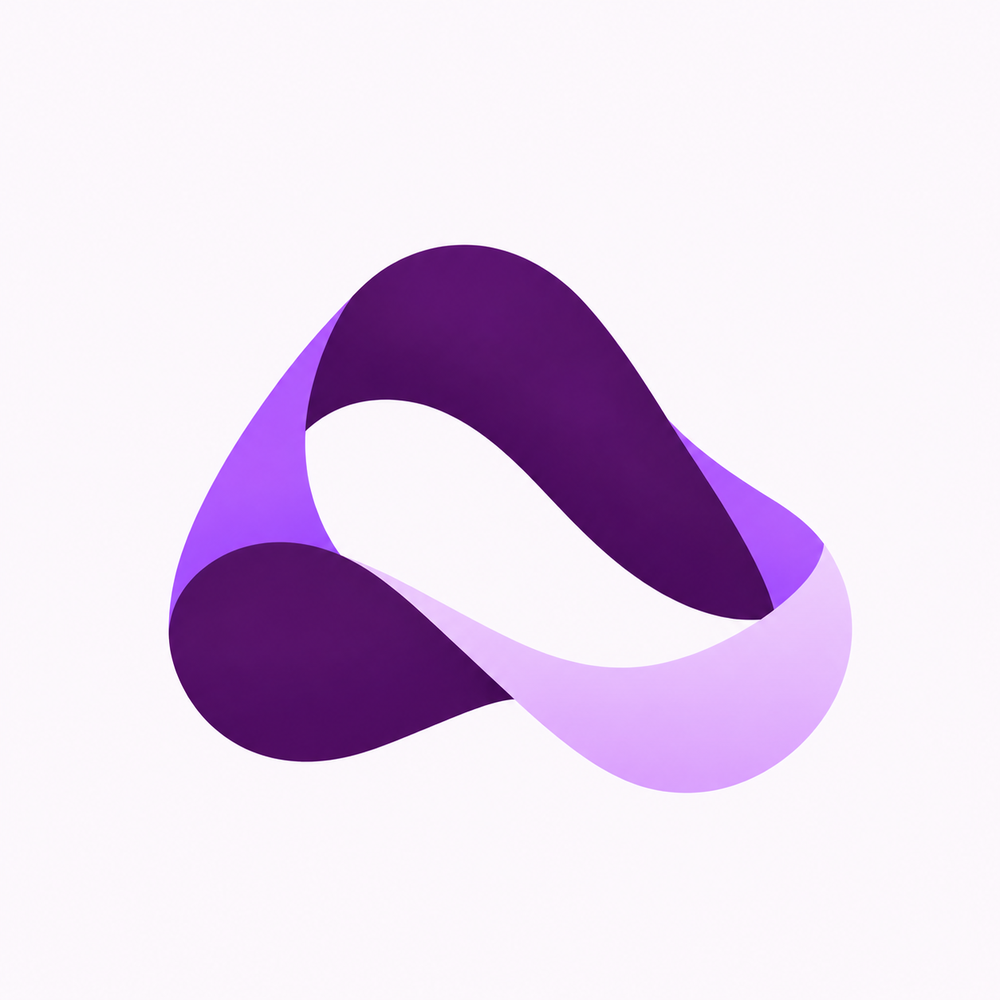
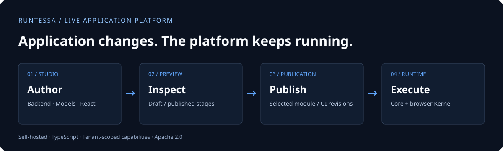
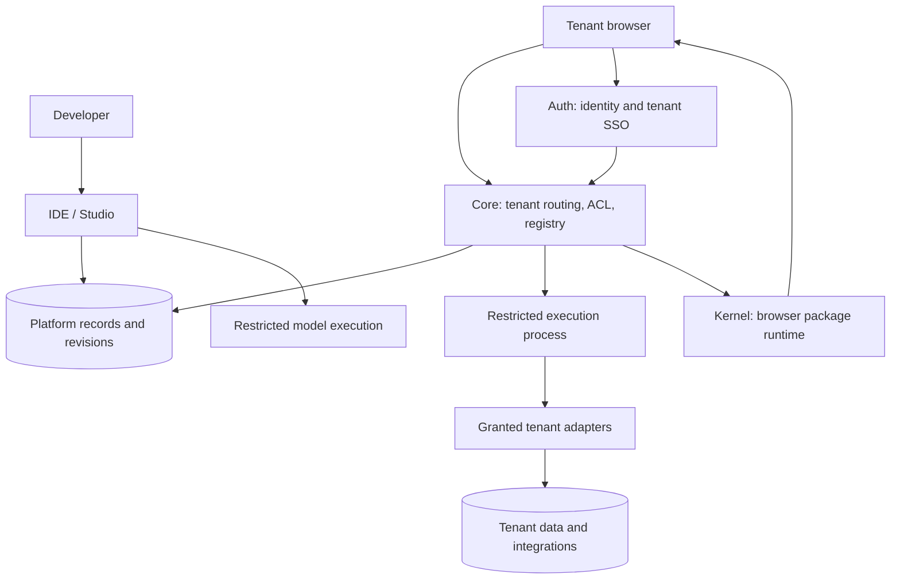

<div align="center">

# Runtessa



### Build the application. Keep the platform running.

A self-hosted TypeScript platform for live tenant backend code, executable data models, and React applications.

[Organization](https://github.com/Runtessa) · [Documentation](docs/README.md) · [Get started](docs/getting-started.md)

[](https://github.com/Runtessa/platform/actions/workflows/secret-scan.yml)
[](https://github.com/Runtessa/platform/actions/workflows/pages.yml)
[](https://github.com/Runtessa/platform/actions/workflows/docker-images.yml)

</div>



**Developer preview · Apache 2.0 · Bring your own infrastructure**

Runtessa gives a tenant application a complete development path: write its backend,
model its data, build its React interface, define access, preview a draft, and
publish a revision. Core selects application code when requests arrive. Kernel
loads the UI packages in the browser. Tenant code changes do not require rebuilding
or restarting the platform services.

The repository includes the runtime, a browser development studio, identity and
SSO, shared packages, a VS Code extension, and optional AI and infrastructure tools.
It is intended for developers evaluating and extending a live application platform.
Read the [validation record](docs/release/validation.md) before deploying: isolation
has targeted tests; unrestricted public code execution, production load guarantees
and full OIDC conformance are not claimed.

## Contents

- [Why Runtessa](#why-runtessa)
- [Platform capabilities](#platform-capabilities)
- [From an edit to a running application](#from-an-edit-to-a-running-application)
- [An application in three layers](#an-application-in-three-layers)
- [Architecture and ownership](#architecture-and-ownership)
- [Data, integrations and secrets](#data-integrations-and-secrets)
- [Getting started](#getting-started)
- [Repository map](#repository-map)
- [Development and verification](#development-and-verification)
- [Deployment boundaries](#deployment-boundaries)
- [Documentation, contribution and license](#documentation-contribution-and-license)

## Why Runtessa

When several applications share a platform, application logic and platform releases
need different lifecycles. Runtessa stores tenant modules and UI packages as
application artifacts, with separate draft and published state. A developer can
change one tenant's application without shipping a new build of Core or the IDE.

The same workspace brings together the pieces that usually live in separate tools:
HTTP handlers, executable ORM models, React packages, access rules, preview,
publication and revision history. Shared projects let teams reuse backend logic
and UI components instead of copying them into every tenant.

Potential applications include internal administration tools, organization-specific
portals, multi-tenant business applications and integration-backed dashboards.
These are use cases for the building blocks, not bundled production applications.

**What “live” means:** tenant code is selected at invocation/package loading time.
Platform source changes still need platform builds. Data-model changes still need
reviewed schema operations. Publishing a module is not a database migration, and
rollback of source is not rollback of data.

## Platform capabilities

| Area | Included behavior | Learn more |
| --- | --- | --- |
| Backend runtime | JavaScript HTTP handlers, route/method matching, tenant selection, response handling and live compilation capabilities | [Backend and models](docs/platform-cookbook/02-backend-modules.md) |
| Data models | Executable TypeORM classes, decorators, methods and relations with named tenant database connections | [Model lifecycle](docs/platform/authoring.md#models-have-a-separate-schema-lifecycle) |
| Browser UI | React UI entities, dependency resolution, styles, route manifests and a session-aware API client through Kernel | [UI cookbook](docs/platform-cookbook/04-ui-modules.md) |
| Studio | Monaco editor, split/diff views, search, draft/published preview, inspection, staging, history and rollback | [Authoring guide](docs/platform/authoring.md) |
| Publication | Separate module/UI draft and published artifacts; revision history and publication request workflows | [Application lifecycle](docs/platform/authoring.md#drafts-and-published-artifacts) |
| Tenant administration | Hostname, teams, adapter grants, secret references, registration policy, branding and optional PWA settings | [Tenant setup](docs/platform-cookbook/01-tenant-config.md) |
| Access control | Team/resource authorization in IDE and permission/role/endpoint ACL in tenant runtime | [ACL cookbook](docs/platform-cookbook/03-acl.md) |
| Identity | Included Auth service for accounts, organizations, roles and tenant OAuth/SSO flows | [Identity boundary](docs/platform/overview.md#identity-and-access) |
| Reuse | Versioned multi-file shared backend projects and UI packages | [Shared projects](docs/platform-cookbook/05-shared-projects.md) |
| Local development | VS Code tenant workspace pull/push, file creation, preview and Codex commands | [Tooling](docs/platform/tooling.md) |
| AI workflows | Workspace-aware assistant tools and optional Codex CLI gateway with streamed execution | [Tooling](docs/platform/tooling.md#assistant-and-codex) |
| Operations | Monitoring samples and alerts, sanitized diagnostics, optional Docker/Podman management and orchestration | [Operational tooling](docs/platform/tooling.md#monitoring-and-container-operations) |

## From an edit to a running application

1. **Author.** Select a tenant in the Studio. Edit backend modules, model files,
   React packages and ACL. Supporting shared code belongs to shared projects.
2. **Save and preview.** Save a draft, then inspect the UI or backend behavior with
   tenant-authorized developer access. Published application traffic stays on the
   selected published module/UI artifacts.
3. **Review and publish.** Inspect diffs and history, select changes and publish
   through the supported workflow. Publication sets the module/UI runtime artifacts
   and invalidates their published caches.
4. **Execute.** Core resolves the tenant, checks access and runs the selected backend
   code in a restricted process. Kernel resolves and loads the selected UI packages.
5. **Iterate.** Edit another draft, compare stages and publish again. Restoring a
   revision restores source to a draft; review and republish it deliberately.

Models, ACL and configuration do not all share module/UI publication semantics.
The [authoring guide](docs/platform/authoring.md) explains the differences.

## An application in three layers

The following example shows an orders application. It needs an `orders` database
adapter grant and configuration, an applied model schema, endpoint ACL and a
published UI entry point. For a first application with no database provisioning,
follow the [HTTP + React walkthrough](docs/tutorials/first-application.md).

### 1. A native data model

Create `Models/Order.js`. TypeORM decorators and classes remain executable code;
models are not reduced to a JSON-only description.

```js
const { Entity, PrimaryGeneratedColumn, Column, CreateDateColumn } = require('typeorm');

@Entity({ name: 'orders' })
class Order {
  @PrimaryGeneratedColumn('uuid') id;
  @Column({ type: 'varchar' }) title;
  @CreateDateColumn() createdAt;
}

module.exports = { Order };
```

Studio model-save actions also attempt tenant schema synchronization through the
model migration endpoint. Plan and back up before saving model changes against
existing data; this is separate from versioned platform migrations. See
[the model guide](docs/platform-cookbook/02-backend-modules.md).

### 2. A tenant backend route

Create a GET module at `/api/orders`. Database access comes from the injected
adapter argument, using the granted `postgres:orders` connection.

```js
module.exports = async function handler(req, adapters) {
  const orm = await adapters.orm('postgres:orders');
  const orders = await orm.getRepository('Order').find({
    order: { createdAt: 'DESC' },
    take: 20,
  });
  return { statusCode: 200, body: { orders } };
};
```

Save and publish the module. Set `orders.read` in the endpoint ACL and assign it to
an appropriate role. Anonymous access must be explicitly enabled for a public route.

### 3. A React entry point

Create the `@app/dashboard` UI entity. Use the Kernel client for tenant API calls;
the example includes loading/error states rather than substituting static data.

```jsx
import React, { useState } from 'react';
import { useApiClient } from '@app/datacontext';

export function App() {
  const api = useApiClient();
  const [orders, setOrders] = useState([]);
  const [busy, setBusy] = useState(false);
  const [error, setError] = useState('');

  async function refresh() {
    setBusy(true);
    setError('');
    try {
      const response = await api.get('/api/orders');
      if (!response.ok) throw new Error(`Request failed (${response.status})`);
      setOrders((await response.json()).orders);
    } catch (failure) {
      setError(failure.message);
    } finally {
      setBusy(false);
    }
  }

  return <section>
    <h1>Orders</h1>
    <button onClick={refresh} disabled={busy}>{busy ? 'Loading…' : 'Load orders'}</button>
    {error && <p role="alert">{error}</p>}
    {orders.map(order => <p key={order.id}>{order.title}</p>)}
  </section>;
}
```

Save, preview and publish the UI. The default application entry point uses a named
`App` export. Other components can be imported by package name. Kernel's API client
returns a standard `Response`, so check its status and decode JSON explicitly.

## Architecture and ownership



| Component | Owns | Does not replace |
| --- | --- | --- |
| **Core** | Tenant runtime configuration, modules/UI registry, ACL, live dispatch and adapter capabilities | Identity administration |
| **IDE / Studio** | Editing, preview, review, publication, history and admin workflows | The Core runtime or Auth identity store |
| **Kernel** | Browser package resolution, caching, styles, routing and API context | A server runtime or a separate deployed service |
| **Auth** | Login, registration, sessions, organizations, roles and tenant sign-in trust | Full tenant application configuration |
| **Shared** | Entities, cross-service contracts, restricted-process helpers and platform migrations | Service controllers and product workflows |

Restricted processes run **inside the existing Core and IDE services**. No additional
execution service, network port or broker is introduced. The parent retains platform
keys and chooses the tenant, stage and granted capabilities. Adapter credentials
for an approved tenant connection are available to that execution context; use
least-privilege database roles and deployment network policy.

PostgreSQL persists the platform records. Redis supports caches and sessions.
Tenant application connections and Auth's identity database have separate roles.
Read the [architecture map](docs/site/docs/architecture/idpcore-map.md) and
[runtime design](docker/runtime/README.md) for exact ownership and isolation limits.

## Data, integrations and secrets

| Integration | Runtime interface | Operator responsibility |
| --- | --- | --- |
| PostgreSQL / MySQL / SQL Server | ORM repositories and lower-level query adapters; read/read-write modes | Named adapter grant, connection secret, schema and DB role |
| Redis | Key/value, expiry and pub/sub | Tenant-appropriate connection and namespace policy |
| Kafka | Message publishing | Broker credentials and topic permissions |
| S3-compatible storage | Object upload and signed URLs | Bucket permissions and storage credentials |
| HTTP | Outbound requests with timeout options | Destination and egress policy |
| Organization directory | Organization, unit and user queries | Auth directory configuration and tenant scope |
| Shared backend packages | Version-aware loading through `adapters.shared.require` | Published package and team ownership |

These are available interfaces, not services automatically provisioned for each
application. PostgreSQL runtime integration is covered by the release tests;
every provider/backend combination has not been validated end to end.

Store secrets through tenant secret storage and reference them in adapter settings.
Do not embed deployment credentials in modules, UI source or public configuration.
Grant checks select capabilities; they do not substitute for database privileges,
bucket policies or network restrictions.

## Getting started

The supported live execution environment is Linux with user namespaces and
bubblewrap. Use Node **22.13+ in the 22.x line**, npm, PostgreSQL 17 and Redis.
The images include bubblewrap; target host/container policy must allow it.
Windows/macOS native live execution is not supported; a compatible Linux VM is an option.

The following is the initial dependency/configuration phase, **not the full install**:

```sh
git clone --recurse-submodules https://github.com/Runtessa/platform.git
cd platform
npm ci
npm --prefix src/auth ci
npm --prefix src/kernel ci
npm --prefix src/monitoring ci
npm --prefix src/container-agent ci
npm run docker:init-env
```

Continue through the [complete installation guide](docs/getting-started.md):

1. Review generated private configuration, local domains and allowed origins.
2. Build the Core, Auth, IDE and monitoring images.
3. Start PostgreSQL/Redis and apply Core/IDE platform migrations.
4. Start the applications and sign in to the IDE with installation credentials.
5. Create a `localhost` tenant and follow the [first application tutorial](docs/tutorials/first-application.md).

| Local surface | Address | Purpose |
| --- | --- | --- |
| IDE | `http://localhost:3002` | Authoring and administration |
| Core | `http://localhost:3005` | Tenant runtime; requires a configured tenant/application |
| Auth | `http://localhost:3015` | Identity and tenant sign-in |

Core and IDE never synchronize platform tables at startup. New installations must
apply the explicit migrations. For existing installations, back up, inspect and
adopt the schema using the [migration guide](scripts/database/README.md). Auth has
its own checksummed SQL migration stream. Generated private configuration is
installation-specific and stays outside Git.

## Repository map

The integration workspace pins nine component repositories at tested commits.
Clone recursively and keep the existing paths for builds and deployment.
See [repository ownership and history](docs/project/repositories.md).


```text
src/
  core/               Tenant runtime, registry, ACL, adapters, server execution
  ideNew/             Next.js Studio, editor, publication and administration
  auth/               Identity service, organizations and tenant sign-in
  kernel/             Browser package/runtime loader
  packages/shared/    Entities, contracts, restricted execution and migrations
  ide-vscode/         Local tenant development extension
  monitoring/         Runtime monitoring and ingest
  container-agent/    Optional Docker/Podman operator agent
  codex-gateway/      Optional Codex CLI HTTP/SSE bridge
docs/
  platform/           Human-written capability, authoring and tooling guides
  tutorials/          Application walkthroughs
  platform-cookbook/  Tenant/backend/UI/ACL/shared recipes
  site/               Docusaurus website and generated reference inventory
  release/            Validation, dependency and release records
scripts/
  database/           Explicit platform schema lifecycle
  security/           Isolation, authorization/logging checks and secret scans
  release/            Installation/image smoke tests and documentation tooling
docker/               Service images, configuration and runtime policy
```

For a runtime change, start at `src/core/server.ts`, the API router, `Dispatcher`
and `SandboxRunner`. For an authoring change, start at the editor components/hooks
and the corresponding IDE API route. For UI loading, start at `src/kernel/src/index.ts`.
The [developer guide](docs/developer-guide.md) connects those paths.

## Development and verification

After installation and platform schema preparation, `npm run apps:dev` runs Core,
IDE and Auth. Optional providers/agents require explicit installation configuration.

| Change area | Useful checks |
| --- | --- |
| Core / shared | `npm run build:shared`, `npm --prefix src/core run build`, `npm --prefix src/core test` |
| IDE access and authoring | `npm --prefix src/ideNew run type-check`, `npm --prefix src/ideNew run test:security` |
| Auth | Server/web build and type checks; `npm run test:auth` |
| Kernel / VS Code | Package builds/types; `npm run vscode:test` executes the isolated extension host |
| Gateway / Agent / shared parsing | `npm run test:contracts` |
| Monitoring | `npm run test:monitoring` (HTTP and actual disposable Redis) |
| Code integrity | `npm run quality:source`; review the [marked duplication inventory](docs/release/code-integrity-audit.md) |
| Restricted execution | `npm run test:runtime`, `npm run test:runtime:integration` |
| Schema and fresh install | `npm run test:database`, `npm run test:installation`, `npm run test:container` |
| Diagnostics and configuration | `npm run test:logging`, `npm run test:env-setup`, `npm run test:tls` |
| Publishable source | `npm run security:secrets`, `npm run security:history`, `npm run security:dependencies` |

Integration/smoke checks use disposable PostgreSQL containers and synthetic
credentials. Runtime checks require the supported Linux host policy. Choose the
checks for the affected behavior; the [validation record](docs/release/validation.md)
distinguishes tested paths from unfinished deployment validation. The dependency
audit deliberately fails while high findings remain.

Build the documentation site with locked dependencies:

```sh
npm --prefix docs/site ci
npm run docs:build
npm run docs:serve
```

The build synchronizes canonical guides and generates route/service inventory.
Edit the source guide rather than its generated copy. The website and technical documentation are English-only.

## Deployment boundaries

- **Process isolation:** live backend/model execution uses restricted Linux processes.
  A compatible namespace/seccomp/MAC policy is required; no in-process fallback is provided.
- **Network:** integrations retain network access. The runtime does not enforce an
  egress allowlist or prevent SSRF; apply network policy before accepting untrusted code.
- **Resources:** V8 heap limits are not total process memory limits. Configure actual
  container memory/CPU, request and temporary-file budgets for the installation.
- **Data:** tenant adapters need narrowly scoped database/storage permissions.
  Platform migrations and tenant model schema actions are different workflows.
- **Operations:** optional engine agents are powerful operator tools. Do not expose
  them publicly or give tenant execution access to the engine socket.
- **Release readiness:** high upstream dependency findings remain documented;
  load testing, restore rehearsals and complete interactive SSO validation need further work.

See [SECURITY.md](SECURITY.md), the [dependency assessment](docs/dependencies.md),
[ROADMAP.md](ROADMAP.md) and the [release runbook](docs/release/README.md).
Cleaning Git history does not revoke previously exposed credentials at their providers.

## Documentation, contribution and license

| Your goal | Start here |
| --- | --- |
| Understand the platform | [Platform tour](docs/platform/overview.md) |
| Install and build a first app | [Installation](docs/getting-started.md) → [HTTP + React tutorial](docs/tutorials/first-application.md) |
| Learn application development | [Cookbook](docs/platform-cookbook/README.md) → [Authoring lifecycle](docs/platform/authoring.md) |
| Work on the platform itself | [Developer guide](docs/developer-guide.md) → [Architecture map](docs/site/docs/architecture/idpcore-map.md) |
| Operate or upgrade a deployment | [Docker guide](docker/README.md) → [Migrations](scripts/database/README.md) → [Security](SECURITY.md) |
| Review APIs | [Generated route inventory](docs/site/docs/reference/routes.md); an inventory, not a tested API specification |
| Contribute | [CONTRIBUTING.md](CONTRIBUTING.md), [Code of Conduct](CODE_OF_CONDUCT.md), [Issues](https://github.com/Runtessa/platform/issues) |

Contributions can improve runtime behavior, authoring tools, examples, accessibility,
tests or documentation. Keep changes focused and include evidence appropriate to
the behavior. Report sensitive security findings privately as described in
[SECURITY.md](SECURITY.md).

Original Runtessa code and documentation use [Apache 2.0](LICENSE), with
[NOTICE](NOTICE). Third-party code and dependencies keep their own licenses;
see [THIRD_PARTY_NOTICES.md](THIRD_PARTY_NOTICES.md). The license allows commercial
use subject to its conditions and does not grant trademark rights.
