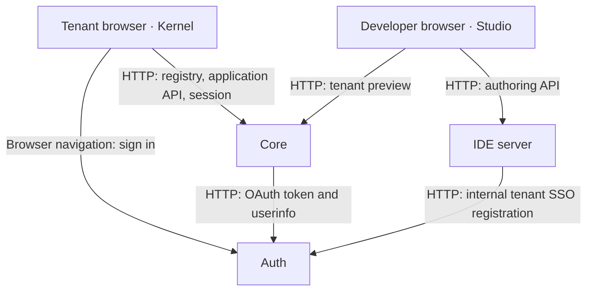
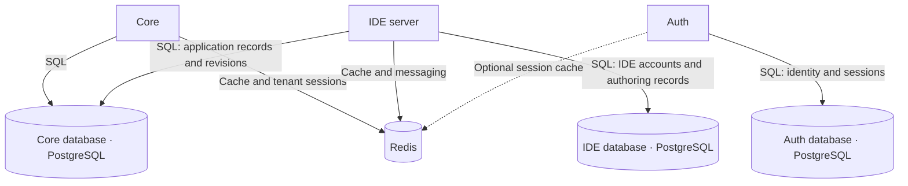
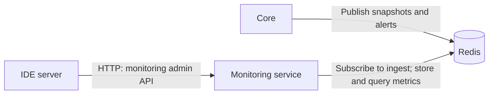
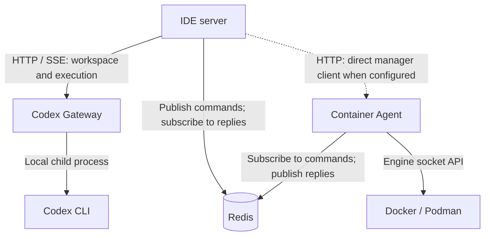

<!-- Generated from docs/architecture/dependency-graph.md; edit the source guide. -->

# Dependency Graph

These diagrams describe the current runtime connections in the repository.
Arrows point from the caller to the service or store it uses. Labels distinguish
HTTP requests, SQL access, Redis messaging and local process execution.
They are not npm import graphs or Compose startup-order graphs.

## Application requests and identity

Kernel executes in the tenant's browser; it is not another server. Studio's
authoring APIs execute in the IDE server. Saving and publishing application
records uses the IDE's direct connection to the Core database, shown below.

The OAuth authorization redirect and callback travel through the browser. They
do not establish an unconditional Auth → Core server dependency. Auth can also
call an optional remote tenant-policy endpoint configured with
`AUTH_TENANT_POLICY_URL`; its destination is installation-specific, and the
example configuration leaves it unset.

Core and IDE each host their own restricted execution processes for runtime
and authoring work. Neither needs a separate execution service.

## Platform storage

The three database nodes represent separate logical databases. The local Compose
installation can host them in one PostgreSQL container. `CORE_DATABASE_URL`
configures the IDE's Core connection; the IDE's own `DATABASE_URL` configures its
separate database. Sharing entity definitions through `@idp/shared` does not make
all services share one database.

Tenant adapters connect to application databases and external systems separately
from these platform stores. See the [platform tour](/docs/platform/overview).

## Monitoring

Core's built-in monitoring publisher uses Redis channel `idp:monitoring:ingest`.
The Monitoring service subscribes to that channel and persists its snapshots,
alerts and rules in Redis. The IDE queries the Monitoring service over HTTP;
it does not require Core to proxy those requests.

## Optional assistant and container tooling

The local Compose file enables Codex Gateway and Container Agent through the
`codex` and `agent` profiles. Gateway operates on configured or hydrated
filesystem workspaces and launches Codex CLI; it is not the tenant application
executor and has no built-in Gateway → Core service dependency.

Container Agent handles lifecycle operations through the Docker/Podman socket.
IDE supports Redis command/reply orchestration as well as configured direct HTTP
clients. The agent can manage Monitoring and Codex Gateway containers; that is
container lifecycle management, not a prerequisite for Core to execute tenant code.

## Source evidence

| Connection | Implementation |
| --- | --- |
| Kernel → Core | [Registry loading and API client](https://github.com/AlirezaDadrass/Idp/blob/main/src/kernel/src/index.ts) |
| IDE → Core database | [Core datasource](https://github.com/AlirezaDadrass/Idp/blob/main/src/ideNew/src/lib/core-db.ts), [module authoring](https://github.com/AlirezaDadrass/Idp/blob/main/src/ideNew/src/pages/api/modules/index.ts), [revision publication](https://github.com/AlirezaDadrass/Idp/blob/main/src/ideNew/src/pages/api/modules/%5Bid%5D.ts) |
| IDE → IDE database | [IDE datasource](https://github.com/AlirezaDadrass/Idp/blob/main/src/ideNew/src/lib/db.ts) |
| Core → Auth | [SSO callback: token exchange and userinfo](https://github.com/AlirezaDadrass/Idp/blob/main/src/core/app/routes/authSsoCallback.ts) |
| IDE → Auth | [Internal tenant SSO registration](https://github.com/AlirezaDadrass/Idp/blob/main/src/ideNew/src/pages/api/admin/tenants/%5Bid%5D.ts) |
| Auth storage and optional integrations | [Auth datasource](https://github.com/AlirezaDadrass/Idp/blob/main/src/auth/lib/typeorm/data-source.ts), [Redis session cache](https://github.com/AlirezaDadrass/Idp/blob/main/src/auth/lib/session-cache.ts), [remote tenant policy](https://github.com/AlirezaDadrass/Idp/blob/main/src/auth/lib/oauth.ts) |
| Core → Redis monitoring channel | [Monitoring publisher](https://github.com/AlirezaDadrass/Idp/blob/main/src/core/core/monitoring/MonitoringService.ts) |
| Monitoring → Redis | [Ingest subscription](https://github.com/AlirezaDadrass/Idp/blob/main/src/monitoring/lib/pubsubIngest.js), [metric storage](https://github.com/AlirezaDadrass/Idp/blob/main/src/monitoring/lib/redisStore.js) |
| IDE → Monitoring | [Monitoring HTTP client](https://github.com/AlirezaDadrass/Idp/blob/main/src/ideNew/src/lib/monitoring-server-client.ts) |
| IDE → Gateway → CLI | [Gateway execution request](https://github.com/AlirezaDadrass/Idp/blob/main/src/ideNew/src/lib/assistant/respond-runtime/codex-client.ts), [CLI runner](https://github.com/AlirezaDadrass/Idp/blob/main/src/codex-gateway/lib/codexRunner.js) |
| IDE / Agent → Redis orchestration | [IDE request/reply client](https://github.com/AlirezaDadrass/Idp/blob/main/src/ideNew/src/lib/container-orchestrator-client.ts), [agent worker](https://github.com/AlirezaDadrass/Idp/blob/main/src/container-agent/lib/redis-orchestrator-worker.js) |
| IDE → Agent HTTP | [Direct manager client](https://github.com/AlirezaDadrass/Idp/blob/main/src/ideNew/src/lib/container-manager-client.ts), [assistant manager client](https://github.com/AlirezaDadrass/Idp/blob/main/src/ideNew/src/lib/assistant/gateway-runtime/container-agent-client.ts) |
| Agent → engine and managed services | [Engine connection](https://github.com/AlirezaDadrass/Idp/blob/main/src/container-agent/index.js), [managed service definitions](https://github.com/AlirezaDadrass/Idp/blob/main/src/container-agent/lib/managedServiceDefinitions.js) |
| Local service deployment | [Compose services and profiles](https://github.com/AlirezaDadrass/Idp/blob/main/docker-compose.yml) |

The diagrams cover these platform paths. Optional SMS, model-provider, tenant
adapter and webhook integrations depend on installation/application settings.
